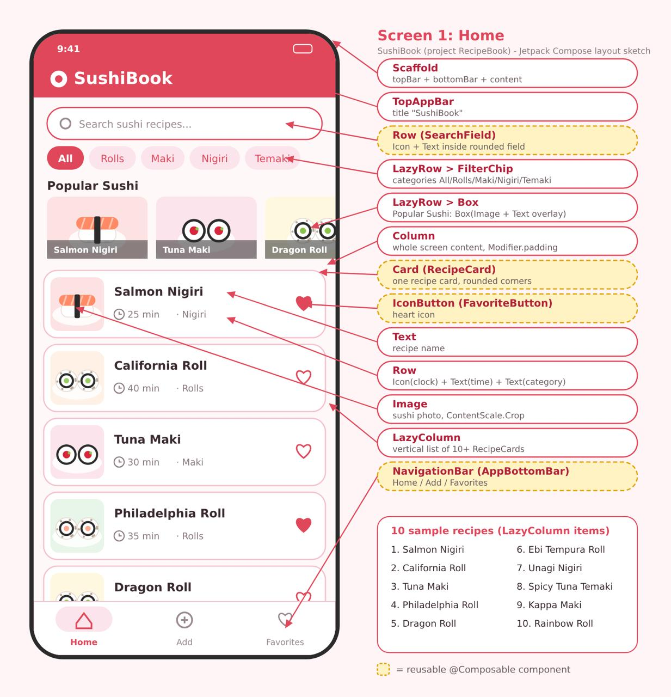
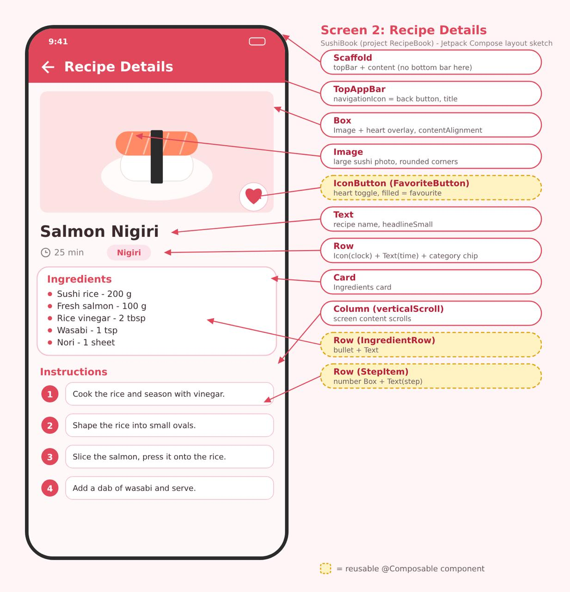
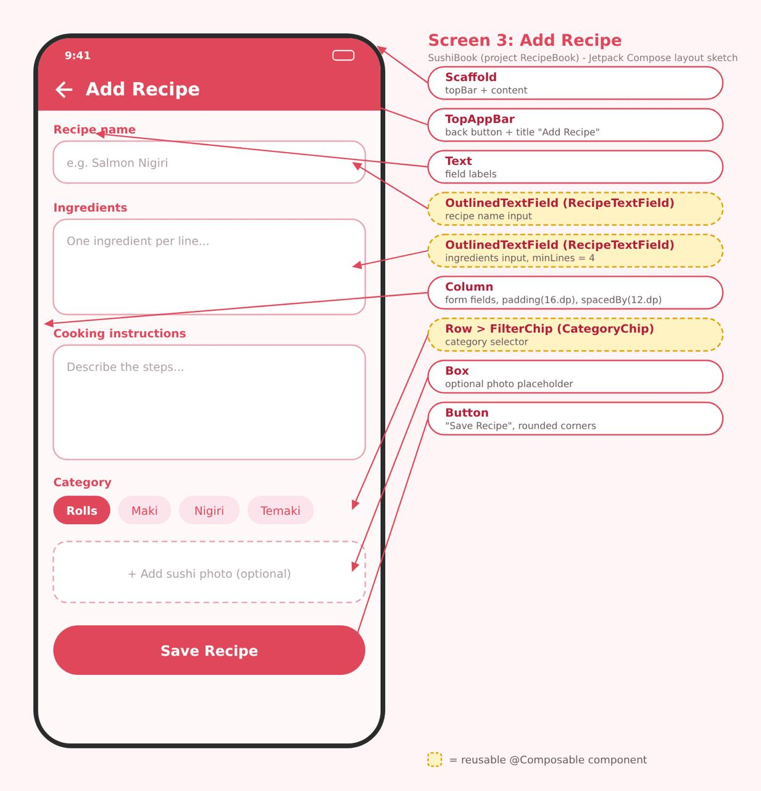
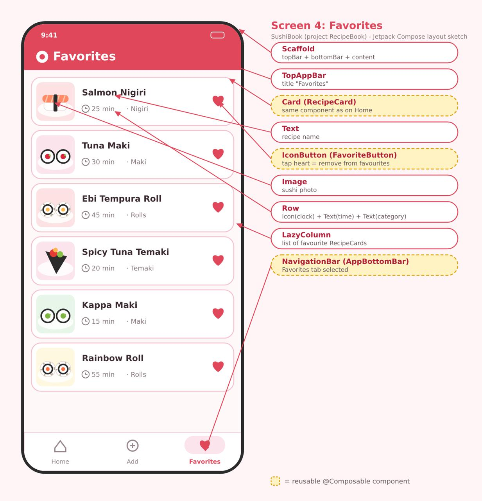

# 🍣 SushiBook

SushiBook is a mobile application built with Kotlin and Jetpack Compose. It helps users explore sushi recipes, save their favorites, and create their own recipes.

The application has a Japanese-inspired design with soft pink, white, and red colors.

## Features

- **Browse Recipes** — view a collection of 10 sushi recipes.
- **Search** — find recipes by name.
- **Filter by Category** — browse Rolls, Maki, Nigiri, and Temaki.
- **Recipe Details** — view descriptions, ingredients, cooking time, and instructions.
- **Add Recipes** — create your own sushi recipes.
- **Favorites** — save and view favorite recipes.
- **Local Storage** — recipes and favorites remain saved after restarting the app.
- **Dark Mode** — supports light and dark system themes.

## Screens

The application includes four main screens:

1. Home Screen
2. Recipe Details Screen
3. Add Recipe Screen
4. Favorites Screen

## Design

The initial screen designs are available in the `design/` directory.

### Home Screen


### Recipe Details


### Add Recipe


### Favorites


## Application Screenshots

Screenshots of the implemented application will be added here.

<!-- Add screenshots of all four screens in light and dark mode. -->

## Technologies

- Kotlin
- Android Studio
- Jetpack Compose
- Material 3
- Navigation Compose
- SharedPreferences
- JSON

## Project Structure

```text
RecipeBook/
├── app/
│   └── src/
│       └── main/
│           ├── java/com/example/recipebook/
│           │   ├── data/
│           │   │   ├── SushiData.kt
│           │   │   └── RecipeStorage.kt
│           │   ├── model/
│           │   │   └── SushiRecipe.kt
│           │   ├── navigation/
│           │   │   └── AppNavigation.kt
│           │   ├── ui/
│           │   │   ├── components/
│           │   │   ├── screens/
│           │   │   └── theme/
│           │   └── MainActivity.kt
│           └── res/
├── design/
├── README.md
└── AI_USAGE.md
```

## How to Run

1. Clone the repository:

   ```bash
   git clone https://github.com/SaparbayevaS/RecipeBook.git
   ```

2. Open the project in Android Studio.

3. Wait for Gradle Sync to finish.

4. Start an Android emulator or connect an Android device.

5. Run the application.

## Minimum Requirements

- Android 7.0 (API 24) or higher.
- Android Studio with Kotlin and Jetpack Compose support.

## Author

Created as a student project for the SIS course.

GitHub: https://github.com/SaparbayevaS
